<p align="center">
  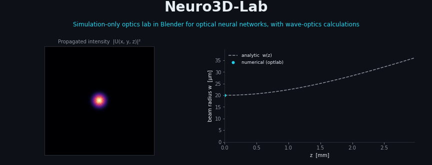
</p>

<p align="center">
  <a href="LICENSE"></a>
  <a href="blender/neuro3d_lab/LICENSE"></a>
  
  
</p>

<p align="center"><b>A virtual optical bench. Blender lays out the bench and shows the result; a tested Python core computes the scalar field.</b></p>

---

## Abstract

Neuro3D-Lab is a simulation project for coherent scalar optical fields. It has two parts:

- **optlab** (`src/optlab`), a NumPy core that propagates a scalar field with the angular-spectrum method. It also contains models of Fresnel interfaces, a Mach–Zehnder interferometer and a phase-only diffractive neural network (D2NN).
- **A Blender add-on** (`blender/neuro3d_lab`) that builds the bench, exports it to optlab and displays the detector intensity that optlab returns.

The project is **not** a physical device. It contains no measured data, and it does not model polarisation, reflections between planes or spectral dispersion. Each quantitative claim is linked to a contract with thresholds, or is labelled exploratory. The D2NN digit experiment is complete (see the results section below): it passes the accuracy and control criteria, and does not show a significant advantage over a linear baseline. A post hoc robustness check at N = 256 (CONTRATO-005), with the same seed and configuration, gives TEST 0.9694 against 0.9639 at N = 128: stable within the pre-registered tolerance, labelled post hoc. A fresh, writer-disjoint test set (CONTRATO-007: 3823 UCI training-file samples never used before, ten seeds) gives 95.1 % for the D2NN, below a DEV-selected small CNN at 96.1 % (paired McNemar p = 0.006 on seed 0). On this evidence the phase-only D2NN does not beat the digital baselines.

---

## Scope of evidence

| Claim | Evidence | Artifact | Status |
|---|---|---|---|
| The scalar angular-spectrum propagator reproduces an analytic Gaussian beam, including its Gouy phase | CONTRATO-002, E1: worst relative error 4.1 × 10⁻⁵ (threshold 5 × 10⁻³) | `experiments/run_validation.py`, `experiments/results/validation_summary.json` | Pass, pre-registered |
| Talbot self-imaging is reproduced at the Talbot distance | CONTRATO-002, E2: worst relative error 2.1 × 10⁻⁶ (threshold 1 × 10⁻²) | same as above | Pass, pre-registered |
| On-axis Fresnel diffraction by a circular aperture matches the analytic formula | CONTRATO-002, E3: worst error 7.2 × 10⁻³ (threshold 5 × 10⁻²) | same as above | Pass, pre-registered |
| Analytic tilted plane waves propagate correctly on the D2NN grid | CONTRATO-004, T1: maximum relative error 3.7 × 10⁻¹⁴ (threshold 1 × 10⁻¹⁰) | `experiments/run_regime_d2nn.py`, `experiments/results/regime_d2nn_summary.json` | Pass, pre-registered |
| The D2NN-grid intensity does not depend on zero padding (N = 128 against N = 256, 18 mm) | CONTRATO-004, T2: relative L2 difference 4.4 × 10⁻² (threshold 2 × 10⁻²) | same as above | Fail, published; a window-size effect of about 4%, most likely from the periodic boundary (mechanism not isolated) |
| The D2NN-grid result is converged in pixel size | CONTRATO-004, T3: relative L2 difference 3.04 (threshold 5 × 10⁻²) | same as above | Fail as pre-registered; an exploratory block sum gives 2.8 × 10⁻², post hoc, not a verdict |
| Behaviour beyond the validity limit of the propagator | E4, one smooth Gaussian input | CONTRATO-002 | Exploratory, no verdict |
| A reversed propagation sign is detected by the Gouy-phase check | Gouy-phase errors of 0.49 and 1.57 rad | CONTRATO-002 (record) | Control, not pre-registered; the script that reproduces it is not yet in the repository |
| Fresnel interfaces, Mach–Zehnder unitarity and related core functions | 32 unit tests pass (`python -m pytest -q`) | `tests/` | Unit tests only; no analytic contract |
| The add-on builds, exports, simulates and imports a bench | Blender self-test: 15 of 15 steps PASS (Blender 4.5.14, headless) | `blender/selftest/run_selftest.py` | Pass; run manually, not in CI |
| The add-on manifest is valid | `blender --command extension validate blender/neuro3d_lab` | `blender/neuro3d_lab/blender_manifest.toml` | Pass |
| The Blender bench image shows the optlab intensity | Visualisation only; planes enlarged 15 times in x and y | `blender/render_bench_gif.py`, `docs/img/blender_bench.gif` | Illustration, not evidence |
| The D2NN classifies handwritten digits above the pre-registered thresholds, and the controls are at chance | CONTRATO-003, H1: TEST mean 0.962 (threshold 0.85); worst seed 0.958 (threshold 0.80); controls C1 to C3 pass | `experiments/run_d2nn_digits.py`, `experiments/results/d2nn_digits_summary.json`, [registry](docs/CONTRACTS/CONTRATO-003-d2nn-digitos.md) | Pass, pre-registered; simulation only, N = 128 grid (see CONTRATO-004, T2) |
| The D2NN classifies digits better than a logistic regression on the same input | CONTRATO-003, H2: difference +0.009 against 0.953 (64 × 64 logistic); McNemar p = 0.22 | `experiments/run_d2nn_digits.py`, `experiments/results/d2nn_digits_summary.json`, [registry](docs/CONTRACTS/CONTRATO-003-d2nn-digitos.md) | Fail, pre-registered; no significant advantage over the linear baseline |
| Any result applies to a physical device or a measurement | None | none | Not claimed; simulation only, no hardware experiment exists |

---

## Pipeline and the Blender bench

<p align="center">
  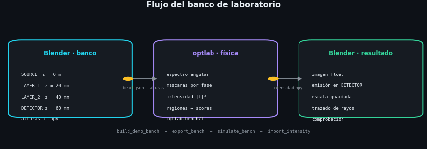
</p>

Blender exports the bench geometry and the phase heights (`optlab.bench/1`). optlab propagates the field and returns the detector intensity. Blender displays that intensity as an emissive image. Blender only visualises; it does not compute the field.

<p align="center">
  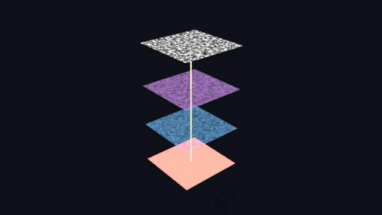
</p>

The bench demo uses N = 256 pixels with an 8 µm pixel, λ = 633 nm, and planes at 0, 20, 40 and 60 mm. It is rendered with Cycles on the CPU. The z spacing is physical, and the self-test checks the demo spacings against the validity limit of the propagator. For visibility only, each plane is enlarged 15 times in x and y, so the image is a schematic and not a to-scale picture. It illustrates optlab output; it is not a measured result.

---

## Physics implemented

### Angular-spectrum propagation

Free-space propagation with the scalar angular-spectrum method. The transfer function applies to propagating components; evanescent components are not propagated. The formula contains no paraxial approximation.

$$U = \mathcal{F}^{-1}\{H\cdot\mathcal{F}\{u_0\}\},\qquad H = \exp\!\left(i\,2\pi d\sqrt{1/\lambda^2 - f_x^2 - f_y^2}\right)$$

The plain method is valid only for $d < N\,dx^2/\lambda$. The simulator refuses out-of-domain segments unless `allow_out_of_domain=True` is passed. The band-limited variant (Matsushima and Shimobaba, 2009) is not implemented in this version.

<p align="center">
  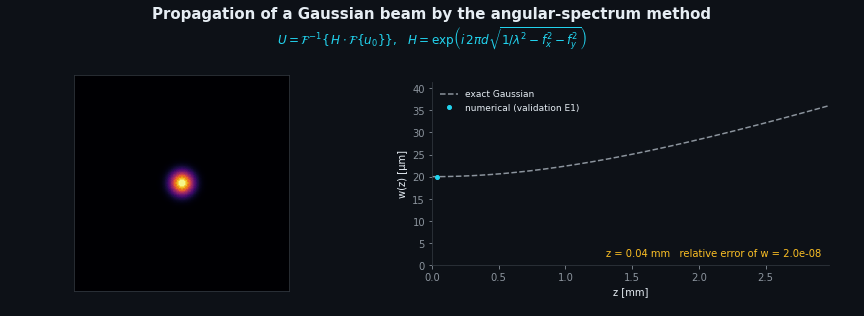
</p>

- **CONTRATO-002, E1:** the width and Gouy phase of a Gaussian beam match the analytic solution, with worst relative error 4.1 × 10⁻⁵ (threshold 5 × 10⁻³). The Gaussian reference is a paraxial solution.
- **CONTRATO-004, T1:** analytic tilted plane waves on the D2NN grid match the analytic solution, with maximum relative error 3.7 × 10⁻¹⁴ (threshold 1 × 10⁻¹⁰).

### Fresnel interfaces

Reflectance and transmittance for normal and oblique incidence, including the Brewster angle and total internal reflection. R + T = 1 holds by construction, so it is not independent evidence. Unit tests cover these functions; there is no analytic contract for them.

<p align="center">
  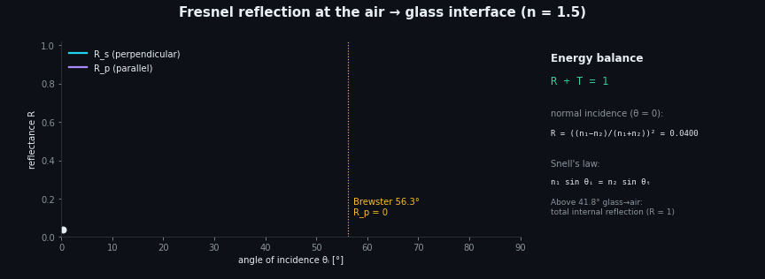
</p>

### Mach–Zehnder interferometer

A unitary matrix made of two 50/50 beam splitters and a phase shifter. With the input at port 1, the output power follows sin²(θ/2). Unitarity is checked at sampled phase values in the unit tests, not over the full range.

<p align="center">
  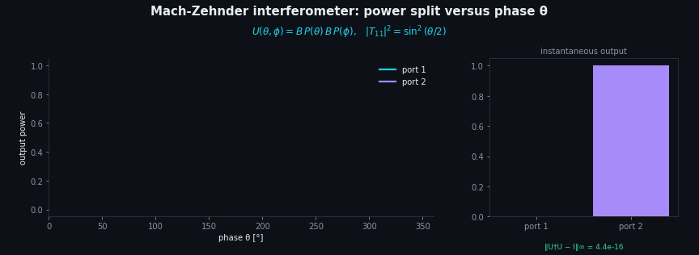
</p>

### Talbot self-imaging

An amplitude grating with period p reproduces its image without a lens at $z_T = 2p^2/\lambda$. At $z_T/2$ the pattern differs from the input. The reference for this effect is paraxial.

<p align="center">
  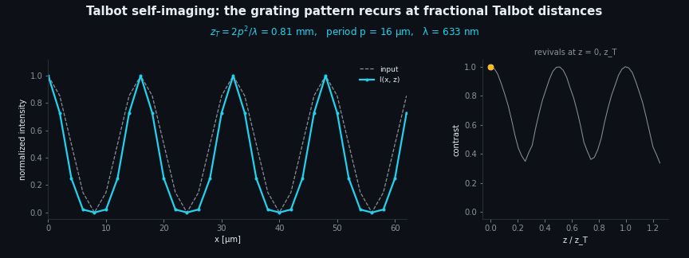
</p>

- **CONTRATO-002, E2:** the relative error at $z_T$ is 2.1 × 10⁻⁶ (threshold 1 × 10⁻²).

### Fresnel diffraction by a circular aperture

On-axis intensity compared with the Fresnel solution $I/I_0 = 4\sin^2(\pi N_F/2)$. The radius used is the effective radius of the sampled aperture, not the nominal radius; the contract declares this.

<p align="center">
  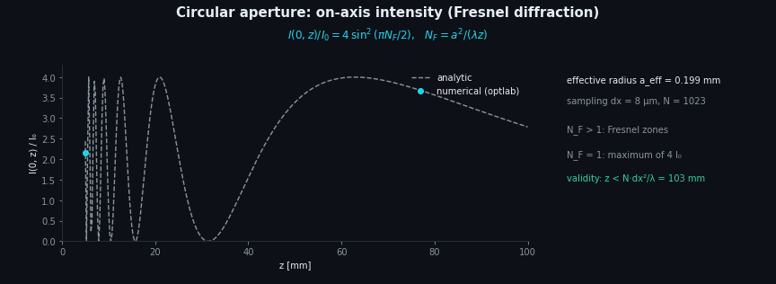
</p>

- **CONTRATO-002, E3:** the worst error is 7.2 × 10⁻³ (threshold 5 × 10⁻²).

---

## Diffractive neural network (D2NN)

The D2NN is a scalar, phase-only model. It has three phase layers, 18 mm between planes, a 128 × 128 pixel grid with pixel pitch 0.4 mm, and a detector of ten regions. The input is a handwritten digit from the scikit-learn digits dataset, normalised to unit energy.

The wavelength is λ = 0.75 mm, which is in the terahertz range and not visible light. The sampling is dx/λ = 0.53, which is coarser than λ/2.

<p align="center">
  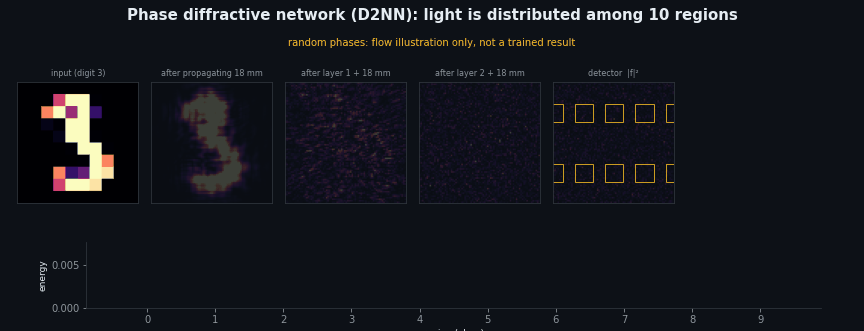
</p>

The animation uses random phases to show how light flows through the network. It is not a trained result.

### Sampling and boundary checks (CONTRATO-004)

- **T1 (pass):** analytic tilted plane waves, as above.
- **T2 (fail):** zero padding. The intensity from the N = 128 grid and from an N = 256 grid with the same pixel pitch differs by a relative L2 of 4.4 × 10⁻² (threshold 2 × 10⁻²). The 4% difference is a window-size effect of the periodic FFT grid. The most likely cause is wrap-around at the 51.2 mm boundary, but this test does not isolate the mechanism.
- **T3 (fail as pre-registered):** pixel convergence, relative L2 3.04 (threshold 5 × 10⁻²). The contract text said "block-averaged", which was wrong. An energy-conserving block sum gives 2.8 × 10⁻²; this is exploratory and post hoc, not a verdict.

These failures are published with their values. D2NN numbers from this grid should be read with the boundary and sampling caveats above.

---

## Scientific method: contracts and verdicts

Each contract states its thresholds. The git history records when each threshold was committed relative to its run; CONTRATO-001 was committed together with its code. This is not an external pre-registration, and no registry timestamp exists. Failures are published with their values.

| Contract | What it tests | Status |
|---|---|---|
| [CONTRATO-001](docs/CONTRACTS/CONTRATO-001-nucleo.md) | Core unit tests and the Blender self-test | `python -m pytest -q`: 32 pass. Blender self-test: 15 of 15 steps PASS |
| [CONTRATO-002](docs/CONTRACTS/CONTRATO-002-validacion-analitica.md) | Analytic validation of the propagator | E1, E2 and E3 pass; E4 exploratory |
| [CONTRATO-003](docs/CONTRACTS/CONTRATO-003-d2nn-digitos.md) | D2NN on handwritten digits, with controls | Complete: H1 pass, H2 not met, controls pass |
| [CONTRATO-004](docs/CONTRACTS/CONTRATO-004-regimen-d2nn.md) | D2NN sampling regime (dx/λ = 0.53) | T1 pass; T2 and T3 fail, published with their values |

**Validation summary**

| Check | Quantity | Result | Threshold | Verdict |
|---|---|---|---|---|
| E1, Gaussian beam width and Gouy phase (CONTRATO-002) | worst relative error | 4.1 × 10⁻⁵ | 5 × 10⁻³ | Pass |
| E2, Talbot self-imaging at $z_T$ (CONTRATO-002) | worst relative error | 2.1 × 10⁻⁶ | 1 × 10⁻² | Pass |
| E3, on-axis circular aperture (CONTRATO-002) | worst error in $I/I_0$ | 7.2 × 10⁻³ | 5 × 10⁻² | Pass |
| E4, smooth Gaussian beyond the validity limit (CONTRATO-002) | not applicable | not applicable | not applicable | Exploratory, no verdict |
| Negative control: reversed propagation sign (CONTRATO-002) | Gouy-phase error | 0.49 and 1.57 rad | not applicable | Detected; control, not pre-registered |
| T1, tilted plane waves (CONTRATO-004) | maximum relative error | 3.7 × 10⁻¹⁴ | 1 × 10⁻¹⁰ | Pass |
| T2, zero padding N = 128 against N = 256 (CONTRATO-004) | relative L2 difference in intensity | 4.4 × 10⁻² | 2 × 10⁻² | Fail |
| T3, pixel convergence (CONTRATO-004) | relative L2 difference in intensity | 3.04 | 5 × 10⁻² | Fail as pre-registered |

<p align="center">
  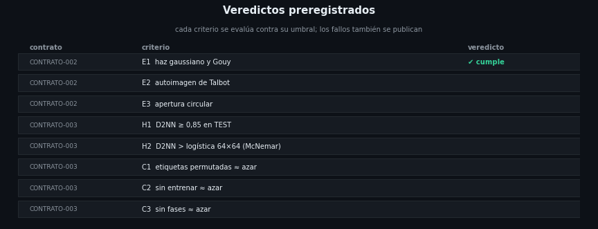
</p>

---

## Digit classification (CONTRATO-003)

A three-layer, phase-only D2NN was trained on handwritten digits (scikit-learn `load_digits`, 8 × 8 images upsampled to 64 × 64). It was evaluated once on TEST (360 images, five seeds). The thresholds were fixed in advance, and the configuration was chosen on DEV only.

| Code | Criterion | TEST result | Verdict |
|---|---|---|---|
| H1 (primary) | Mean over 5 seeds ≥ 0.85, and each seed ≥ 0.80 | mean 0.962, minimum 0.958 | Pass |
| H2 | D2NN beats a logistic regression on the same input (paired difference ≥ 0 and McNemar p < 0.05) | +0.009 against 0.953; p = 0.22 | Fail |
| C1 | Permuted training labels: mean ≤ 0.15 | 0.126 | Pass |
| C2 | Untrained random phases: mean ≤ 0.20 | 0.124 | Pass |
| C3 | No phase layers: ≤ 0.20 | 0.025 | Pass |

The D2NN classifies well above chance and above the H1 threshold. It does **not** beat the linear baseline significantly: the difference from the 64 × 64 logistic regression is +0.009 (McNemar exact p = 0.22). This is a simulation. The grid is the one that CONTRATO-004 flags (about a 4 % window-size effect), and the N = 256 robustness check is pending as CONTRATO-005.

The full registry, the per-seed intervals and the confusion-matrix diagonal are in [CONTRATO-003](docs/CONTRACTS/CONTRATO-003-d2nn-digitos.md).

<p align="center">
  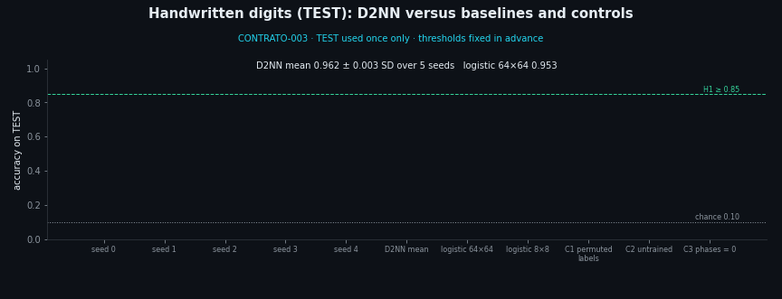
</p>

<p align="center">
  
</p>

---

## Limitations

- **Scalar model.** There is no polarisation and no vector field. The scalar model may not hold for light scattered by pixel-scale structure at large angles, which is the regime of the D2NN grid.
- **No plane-to-plane reflections and no spectral dispersion** are modelled.
- **Periodic boundary.** The FFT propagator wraps light around the window; see T2.
- **Sampling regime.** The D2NN grid (dx/λ = 0.53) lies outside the range of the analytic checks in CONTRATO-002, which used dx/λ between 3 and 13. Only CONTRATO-004 tests this regime, and its T2 and T3 checks failed.
- **Validity limit.** The plain angular spectrum is valid for $d < N\,dx^2/\lambda$, and the band-limited variant is not implemented. Behaviour beyond the limit is examined only by E4, which uses one smooth Gaussian input and has no verdict.
- **Relative intensity.** The results are not calibrated in watts. Detection is ideal: there is no noise and no quantisation.
- **Simulation only.** No physical hardware exists, and no measured data are used.
- **Benchmark.** The digits dataset is small (8 × 8 pixels), so the results are not directly comparable with published D2NN results.
- **Internal verification.** The tests and contracts were written and run within the project. No external reviewer has reproduced the results yet.
- **Blender self-test.** It is run manually and is not part of continuous integration.

---

## Installation and reproduction

Requirements: Python 3.10 or newer (`requires-python` in `pyproject.toml`). optlab installs NumPy and SciPy. Blender 4.5.14 is needed only for the add-on checks.

Core install, unit tests and analytic validation:

```bash
python -m pip install -e ".[dev]"
python -m pytest -q
python experiments/run_validation.py
```

Blender add-on self-test and manifest validation (replace `path/to/blender` with your Blender 4.5.14 executable):

```bash
"path/to/blender" -b --factory-startup -P blender/selftest/run_selftest.py
"path/to/blender" --command extension validate blender/neuro3d_lab
```

Bench GIF (the second step needs Pillow):

```bash
"path/to/blender" -b --factory-startup -P blender/render_bench_gif.py
python blender/render_bench_gif.py --gif
```

D2NN experiments and README figures (install the optional extras first):

```bash
python -m pip install -e ".[experiments,figures]"
python experiments/run_regime_d2nn.py    # CONTRATO-004
python experiments/run_d2nn_digits.py    # CONTRATO-003, about 3.6 h on CPU
python docs/figures/make_figures.py      # README figures
```

By default, outputs go to `.cognition/neuro3d-lab` in the folder above the repository. Set `NEURO3D_LAB_OUT` to use another folder.

Continuous integration (`.github/workflows/tests.yml`) runs `pytest -q` on Ubuntu with Python 3.13 for pushes and pull requests to `master`. It does not run the Blender self-test.

---

## Repository structure

```
src/optlab/                  scalar-field core in NumPy: propagation, Fresnel, interferometer, elements, D2NN, bench
blender/neuro3d_lab/         Blender add-on (GPL-3.0-or-later): build, export, import, operators
blender/selftest/            headless self-test of the add-on
blender/render_bench_gif.py  renders the bench GIF
experiments/                 scripts for CONTRATO-002, CONTRATO-003 and CONTRATO-004
experiments/results/         versioned summaries of the contracts
docs/                        model, architecture and contracts
docs/figures/                generator of the README figures
coordinacion/                coordination records and review responses
tests/                       unit tests for the core
.github/workflows/           continuous integration (unit tests)
```

---

## Related projects

These open-source projects are related. No numerical comparison with them has been made yet.

- Blender Optics Simulator
- BlenderPhotonics
- TorchOptics
- onn-simulation
- POPPY

---

## References

- Lin, X. et al. All-optical machine learning using diffractive deep neural networks. Science (2018). [doi:10.1126/science.aat8084](https://doi.org/10.1126/science.aat8084) · [arXiv:1804.08711](https://arxiv.org/abs/1804.08711)
- Matsushima, K. & Shimobaba, T. Band-limited angular spectrum method for numerical simulation of free-space propagation in far and near fields. Optics Express 17, 19662 (2009).
- Clements, W. R. et al. An optimal design for universal multiport interferometers. Optica (2016). [doi:10.1364/OPTICA.3.001460](https://doi.org/10.1364/OPTICA.3.001460)

Related work by the author: [Neuro3D](https://github.com/Agnuxo1/Neuro3D), [Silice-Neuro3D-Cube](https://github.com/Agnuxo1/Silice-Neuro3D-Cube), [NeuroPixel](https://github.com/Agnuxo1/NeuroPixel) and [OpenCLAW-P2P](https://github.com/Agnuxo1/OpenCLAW-P2P).

---

## Contributing and roadmap

See [CONTRIBUTING.md](CONTRIBUTING.md) for the workflow and [ROADMAP.md](ROADMAP.md) for planned work.

---

## How to cite

Use the metadata in [CITATION.cff](CITATION.cff) (version 0.1.0). GitHub's "Cite this repository" button reads this file. No DOI has been assigned yet.

---

## Licence

- **optlab core** (`src/optlab`): Apache License 2.0.
- **Blender add-on** (`blender/neuro3d_lab`): GNU General Public License v3.0 or later (GPL-3.0-or-later), with its own [LICENSE](blender/neuro3d_lab/LICENSE) file. The add-on uses GPL-3.0-or-later because the official Blender extensions catalogue requires GPL-3.0-or-later for add-ons, and the add-on imports optlab.

Repository licence text: [LICENSE](LICENSE) and [NOTICE](NOTICE). Blender itself is not redistributed in this repository.

Author: Francisco Angulo de Lafuente ([Agnuxo1](https://github.com/Agnuxo1)).
